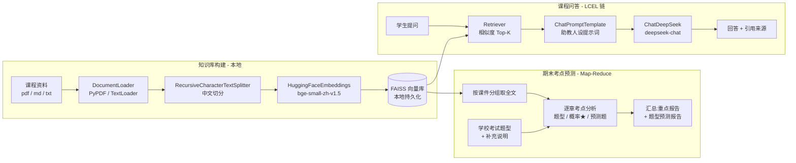

# 🎓 苏老师 · 课程助教

> 基于 **LangChain 框架** 构建的课程知识库问答与期末考点预测系统:把你的课程课件喂给一位"私人助教"——**苏老师**,她只依据你上传的课件回答问题(句句附引用来源),还能按你们学校的考试题型逐章分析课件,生成《考试重点报告》与《题型预测报告》。

技术栈:**LangChain(LCEL)+ DeepSeek + 本地 bge 中文 Embedding + FAISS + Streamlit**

---

## 一、为什么需要这个软件?

通用大模型(ChatGPT / DeepSeek 等)确实"什么都会答",但把它直接当**课程学习工具**有四个无法回避的问题,这个项目就是针对它们设计的:

| # | 直接问通用大模型的问题 | 苏老师的解法 |
|---|----------------------|-------------|
| 1 | **不对齐课程**:它答的是"全网标准答案",可能超纲、记号与口径和你老师的课件不一致 | 回答**只依据你上传的课件**,答的就是"这门课的答案" |
| 2 | **编造无从核对**:一本正经胡说时,学生没有鉴别能力 | **每条回答附引用来源**(出自哪份课件);资料里没有的明确回答"未涉及",绝不编造 |
| 3 | **期末复习抓不住重点**:每个学校、每个专业的考试范围和题型都不一样,课件几十上百页,自己划重点既费时又容易漏 | **考点预测**:告诉她你们学校的题型,她逐章分析课件,输出各章出题概率、预测例题和复习时间分配 |
| 4 | **资料隐私**:课件全文交给第三方平台有泄露顾虑 | 课件在**本地**完成向量化建库,知识库不离开你的电脑 |

一句话:**通用大模型给你"网上的标准答案",苏老师给你"这门课的答案"和"这场考试的攻略"。**

## 二、设计理念

1. **人格化,而不是一个冷冰冰的对话框。** 助教被设计成有形象、有性格的"苏老师":进入系统她会站在黑板前挥手打招呼;她有性格标签(耐心指数 ★★★★★、口头禅"翻课件!");她的开场白立下承诺——"答不上来算我输,但答完要回去翻课件复习哦"。人格化降低了使用门槛:学生不需要看说明书,看到对话就知道该做什么。
2. **有据可依(Grounded),宁可不答也不瞎答。** 整个系统围绕 RAG(检索增强生成)构建:先从你的课件里检索最相关的片段,再要求模型"只依据资料作答"。这是与"直接问大模型"最本质的区别。
3. **为"考试"这个场景特化。** 单纯问答只是起点;期末才是学生的真实刚需。考点预测采用 **map-reduce 式两阶段分析**:逐章提取考点与题型匹配度,再汇总成全局报告——课件再多也不会撑爆模型上下文。
4. **本地优先。** 课件解析、切分、向量化、检索全部在本机完成;只有"问题 + 检索到的片段"会发送给在线大模型。知识库可随时删除重建(`data/vectorstore/`)。
5. **零命令行门槛。** 上传课件、构建知识库、提问、生成报告、下载报告,全部在网页内完成。

## ✨ 功能特色

- **👩‍🏫 助教人格「苏老师」**:黑板粉笔风首页,SVG 手绘人物会挥手打招呼(动态动画),性格标签卡 + 三张问题卡一键开讲。
- **💬 课程知识库问答(RAG)**:检索增强生成,回答严格依据课件,附引用来源;资料外问题明确回答"未涉及"。
- **📝 期末考点预测报告**:告诉苏老师你们学校的题型(可补充考试范围/分值说明),她逐章分析课件,生成含出题概率星级、预测例题与答题要点、复习时间分配的报告,支持一键下载 Markdown。
- **🖥️ 网页内管理知识库**:侧边栏直接上传 `pdf / txt / md`,一键构建/重建,零命令行。
- **🔒 本地化 Embedding**:中文向量化使用开源模型 `bge-small-zh-v1.5`,在本地运行,课件不出本机。
- **🧵 对话式交互**:多轮提问、历史记录、一键清空、Student/Teacher 双气泡样式。

## ⛓️ 基于 LangChain 框架的实现(核心)

本项目**严格按照实验要求,基于 LangChain 框架**构建(基于 LangChain 1.x,LCEL 表达式链)。系统的两条核心链路——课程问答与考点预测——都由 LangChain 组件组装而成:

### 1. LangChain 组件使用一览

| LangChain 组件 | 所用集成包 | 在本项目中的作用 |
|---------------|-----------|----------------|
| **Document Loaders** 文档加载 | `langchain-community` | `PyPDFLoader` / `TextLoader` 加载 `docs/` 下的 PDF 与文本课件,并在 metadata 中记录来源文件名 |
| **Text Splitter** 文本切分 | `langchain-text-splitters` | `RecursiveCharacterTextSplitter` 把长课件切成 500 字符、相邻重叠 50 的文本块,针对中文定制分隔符(`。`、换行等) |
| **Embeddings** 向量化 | `langchain-huggingface` | `HuggingFaceEmbeddings` 封装本地中文模型 `BAAI/bge-small-zh-v1.5`,把文本块与用户问题映射到同一语义向量空间 |
| **Vector Store** 向量库 | `langchain-community` | `FAISS.from_documents()` 建库,`save_local()/load_local()` 持久化,`as_retriever()` 转成检索器 |
| **Retriever** 检索器 | `langchain-core` | `retriever.invoke(question)` 按相似度取 Top-4 最相关片段 |
| **Prompt Template** 提示词模板 | `langchain-core` | `ChatPromptTemplate` 管理"课程助教"人设提示词,注入检索到的 context 与用户 question |
| **Chat Model** 对话模型 | `langchain-deepseek` | `ChatDeepSeek(model="deepseek-chat")` 封装 DeepSeek 在线模型,完全兼容 LangChain ChatModel 接口 |
| **Output Parser** 输出解析 | `langchain-core` | `StrOutputParser()` 把模型消息解析为纯文本 |
| **LCEL** 链式编排 | `langchain-core` | 用 `\|` 运算符把上述组件声明式地组合成一条链(`rag/chain.py`) |

### 2. 课程问答链(LCEL)

```python
# rag/chain.py —— LangChain Expression Language
{
    "context":  retriever | RunnableLambda(format_docs),   # 检索 → 格式化
    "question": RunnablePassthrough(),                     # 问题透传
} | prompt          # ChatPromptTemplate 注入人设与资料
  | llm             # ChatDeepSeek(deepseek-chat)
  | StrOutputParser()
```

一次 `chain.invoke(question)` 即完成"检索 → 组装提示词 → 生成 → 解析"全过程。

### 3. 考点预测链(基于 LangChain 的 map-reduce)

`rag/exam.py` 复用同一个 `ChatDeepSeek` 封装,实现两阶段分析:

```
FAISS 文档库 → 按课件(章)分组
   → 第一阶段(map):每章独立调用模型分析 → 核心考点 / 出题概率★ / 预测例题 / 答题要点
   → 第二阶段(reduce):汇总各章结果 → 总报告(优先级总览 + 重点报告 + 题型预测 + 临考叮嘱)
```

### 4. 为什么选择 LangChain?

- **组件标准化**:加载、切分、向量化、检索、提示词、模型、解析各有标准接口,拼装即用,让我们把精力放在产品设计而非胶水代码上。
- **模型可替换**:得益于 LangChain 的抽象,把 DeepSeek 换成 `ChatOpenAI`、`ChatTongyi` 或本地 `ChatOllama` 只需改一行,应用的其余部分完全不动。
- **LCEL 可读可维护**:整条 RAG 链是一个声明式表达式,数据流向一目了然,也方便后续插入记忆、流式输出等组件。

## 🏗️ 系统架构



## 🚀 快速开始

### 1. 环境要求

- Python 3.10+
- 一个 [DeepSeek API Key](https://platform.deepseek.com/api_keys)(仅对话模型调用在线接口;向量化在本地完成)

### 2. 安装依赖

```bash
# 建议创建独立虚拟环境
python -m venv .venv
# Windows
.venv\Scripts\activate
# macOS / Linux
source .venv/bin/activate

pip install -r requirements.txt
```

### 3. 配置 API Key

```bash
cp .env.example .env
# 编辑 .env,填入:DEEPSEEK_API_KEY=sk-xxxx
```

### 4. 构建知识库

**方式一:网页内上传(推荐)** —— 启动应用后(见第 5 步),在左侧边栏上传课件并点击「🔨 构建 / 重建知识库」,全程无需命令行。

**方式二:命令行** —— 把课件放进 `docs/` 目录(支持 pdf / md / txt),然后运行:

```bash
python ingest.py
```

首次运行会自动从 HuggingFace 镜像下载 embedding 模型(约 100 MB),之后离线可用。项目自带《计算机网络》示例资料,可直接体验。

### 5. 启动应用

```bash
streamlit run app.py
```

浏览器会自动打开 `http://localhost:8501`:

- **💬 问苏老师**:点问题卡或直接输入问题,例如"什么是三次握手?为什么需要三次?"
- **📝 期末考点预测**:勾选你们学校的题型(可补充说明),点击"🔍 生成考点预测报告"

也可以用命令行快速自测问答链路:

```bash
python query.py "什么是三次握手?为什么需要三次?"
```

## 📁 项目结构

```
course-rag-qa/
├── app.py                  # Streamlit 界面(苏老师人格 + 问答/考点预测双标签)
├── ingest.py               # 知识库构建入口(加载→切分→向量化→持久化)
├── query.py                # 命令行问答自测(不启动浏览器)
├── config.py               # 模型与检索参数配置
├── rag/
│   ├── loader.py           # LangChain DocumentLoader + TextSplitter
│   ├── vectorstore.py      # LangChain Embeddings + FAISS VectorStore / Retriever
│   ├── chain.py            # LCEL 问答链(检索→PromptTemplate→ChatDeepSeek→解析)
│   └── exam.py             # 考点预测:基于 LangChain 的 map-reduce 两阶段分析
├── docs/                   # 课程资料目录(网页上传后也保存在这里)
├── data/vectorstore/       # FAISS 向量库(自动生成,不入库)
├── requirements.txt
└── .env.example            # 环境变量示例
```

## ⚙️ 可调参数

在 `config.py` 中修改:

| 参数 | 默认值 | 说明 |
|------|--------|------|
| `CHUNK_SIZE` | 500 | 每个文本块的目标长度(字符) |
| `CHUNK_OVERLAP` | 50 | 相邻块重叠长度,避免语义被切断 |
| `RETRIEVER_K` | 4 | 每次检索返回的最相关片段数 |
| `EMBEDDING_MODEL` | bge-small-zh-v1.5 | 本地中文 Embedding 模型 |
| `CHAT_MODEL` | deepseek-chat | 在线生成模型 |

## 🔬 技术要点

- **回答为什么不编造?** 提示词约束"只依据资料回答,未涉及要明说";RAG 把生成依据限定在检索片段内;考点预测的 temperature 降到 0.3,让分析克制、贴原文。
- **考点预测如何避免撑爆上下文?** map-reduce 两阶段:逐章分析各自独立调用,再汇总各章结论生成总报告(`rag/exam.py`)。
- **为什么用本地 Embedding?** DeepSeek 不提供向量化接口;`bge-small-zh-v1.5` 是中文语义检索效果优异的开源模型,本地运行无隐私顾虑。
- **为什么选 FAISS?** 纯 `pip` 安装、无需部署数据库服务、毫秒级相似度检索,支持本地持久化,重启无需重建索引。

## 🛠️ 常见问题

- **报错 `向量库不存在`**:先构建知识库(网页内点击构建按钮,或运行 `python ingest.py`);更换课件后需重新构建。
- **下载模型慢/失败**:确认网络可访问 `hf-mirror.com`(国内镜像已默认启用),或手动设置 `HF_ENDPOINT` 环境变量。
- **提示 API Key 无效**:检查 `.env` 中 `DEEPSEEK_API_KEY` 是否填写正确、账户是否有余额。

## 📄 License

[MIT](LICENSE)
