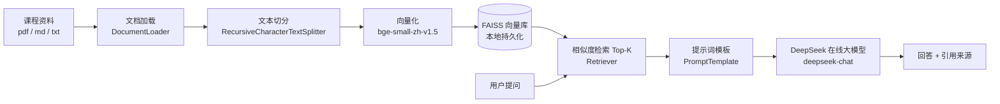

# 📚 课程知识库问答助手(Course RAG QA)

基于 **LangChain + DeepSeek + FAISS + Streamlit** 的检索增强生成(RAG)智能应用:把你的课程资料(PDF / Markdown / TXT)导入本地知识库,即可用自然语言提问,系统会检索最相关的课件片段,交给大模型生成**有据可依、附带引用来源**的回答。

> 适用场景:课程复习答疑、讲义速查、自学辅助。内置了一份《计算机网络》示例资料,开箱即可体验。

## ✨ 功能特性

- **👩‍🏫 助教人格「苏老师」**:黑板粉笔风首页,人物形象(SVG 手绘)进入系统即打招呼,性格标签卡 + 三张问题卡一键开讲,聊天气泡式交互。
- **界面内上传课件**:侧边栏直接上传 `pdf / txt / md`,一键构建/重建知识库,全程零命令行。
- **本地知识库检索增强**:回答严格基于你导入的课程资料,资料中没有的内容会明确回答"未涉及",有效抑制大模型幻觉。
- **引用来源追溯**:每条回答下方标注信息来自哪份课件,方便核对原文。
- **本地化 Embedding**:中文向量化使用开源模型 `bge-small-zh-v1.5`,在本地运行,文档内容不上传第三方。
- **对话式界面**:Streamlit 聊天界面,支持多轮提问、历史记录与一键清空。

## 💡 为什么不直接问 DeepSeek / ChatGPT?

通用大模型确实"什么都会答",但**"什么都会答"恰恰是它做课程答疑的短板**——它不知道你这门课的老师讲了什么、讲到什么深度、用了什么口径:

| 对比点 | 直接问通用大模型 | 本助手(RAG) |
|--------|----------------|-------------|
| 回答依据 | 全网通用知识,来源不明 | **只依据你上传的课件与讲义** |
| 与课程对齐 | 可能超纲、记号和口径与教材不一致 | 按老师课件的口径与深度回答 |
| 可信度 | 可能一本正经地编造,无从核对 | **每条回答附引用来源**,可翻回课件核对 |
| 范围控制 | 什么都会扯,容易带到没学过的内容 | 资料外的问题明确回答"课程资料中未涉及" |
| 资料隐私 | 课件全文需交给第三方平台 | 课件留在本地构建索引,仅检索出的片段参与生成 |
| 迁移复用 | 换场景需重新调教 | 换一批课件即变成考研 / 考证 / 课程设计助手 |

一句话:**通用大模型给你"网上的标准答案",这个助手给你"这门课的答案"。**

## 🏗️ 系统架构



对应的 LangChain 组件链路(LCEL 表达式):

```python
{"context": retriever | format_docs, "question": passthrough} | prompt | llm | StrOutputParser()
```

## 🚀 快速开始

### 1. 环境要求

- Python 3.10+
- 一个 [DeepSeek API Key](https://platform.deepseek.com/api_keys)(仅需对话模型,向量化在本地完成)

### 2. 安装依赖

```bash
# 建议创建独立虚拟环境
python -m venv .venv
# Windows
.venv\Scripts\activate
# macOS / Linux
source .venv/bin/activate

pip install -r requirements.txt
```

### 3. 配置 API Key

```bash
# 复制示例配置并填入你的 Key
cp .env.example .env
# 编辑 .env,填入:DEEPSEEK_API_KEY=sk-xxxx
```

### 4. 构建知识库

**方式一:网页内上传(推荐)** —— 启动应用后(见第 5 步),在左侧边栏上传课件并点击「🔨 构建 / 重建知识库」,全程无需命令行。

**方式二:命令行** —— 把课件放进 `docs/` 目录(支持 pdf / md / txt),然后运行:

```bash
python ingest.py
```

首次运行会自动从 HuggingFace 镜像下载 embedding 模型(约 100 MB),之后离线可用。项目自带《计算机网络》示例资料,可直接体验。

### 5. 启动应用

```bash
streamlit run app.py
```

浏览器会自动打开 `http://localhost:8501`,输入问题即可提问,例如:"什么是三次握手?为什么需要三次?"

也可以不启动浏览器,用命令行快速自测整条链路:

```bash
python query.py "什么是三次握手?为什么需要三次?"
```

## 📁 项目结构

```
course-rag-qa/
├── app.py                  # Streamlit 聊天界面
├── ingest.py               # 知识库构建入口(加载→切分→向量化→持久化)
├── query.py                # 命令行问答自测(不启动浏览器)
├── config.py               # 模型与检索参数配置
├── rag/
│   ├── loader.py           # 文档加载与文本切分
│   ├── vectorstore.py      # Embedding 与 FAISS 向量库管理
│   └── chain.py            # RAG 问答链(检索→提示词→DeepSeek)
├── docs/                   # 课程资料目录(放入你的 pdf/md/txt)
├── data/vectorstore/       # FAISS 向量库(自动生成,不入库)
├── requirements.txt
└── .env.example            # 环境变量示例
```

## ⚙️ 可调参数

在 `config.py` 中修改:

| 参数 | 默认值 | 说明 |
|------|--------|------|
| `CHUNK_SIZE` | 500 | 每个文本块的目标长度(字符) |
| `CHUNK_OVERLAP` | 50 | 相邻块重叠长度,避免语义被切断 |
| `RETRIEVER_K` | 4 | 每次检索返回的最相关片段数 |
| `EMBEDDING_MODEL` | bge-small-zh-v1.5 | 本地中文 Embedding 模型 |
| `CHAT_MODEL` | deepseek-chat | 在线生成模型 |

## 🔬 技术要点

- **为什么回答不编造?** 提示词中明确约束"只依据资料回答,未涉及要明说",并使用 `temperature=0.7` 平衡流畅与忠实;RAG 把生成依据限定在检索到的片段内。
- **为什么用本地 Embedding?** DeepSeek 不提供向量化接口;`bge-small-zh-v1.5` 是中文语义检索效果优异的开源模型,本地运行无文档隐私顾虑。
- **为什么选 FAISS?** 纯 `pip` 安装、无需部署数据库服务、毫秒级相似度检索,并支持 `save_local` / `load_local` 持久化,重启无需重建索引。

## 🛠️ 常见问题

- **报错 `向量库不存在`**:先运行 `python ingest.py`;更换 `docs/` 中的资料后需要重新运行。
- **下载模型慢/失败**:确认网络可访问 `hf-mirror.com`(国内镜像已默认启用),或手动设置 `HF_ENDPOINT` 环境变量。
- **提示 API Key 无效**:检查 `.env` 中 `DEEPSEEK_API_KEY` 是否填写正确、账户是否有余额。

## 📄 License

[MIT](LICENSE)
